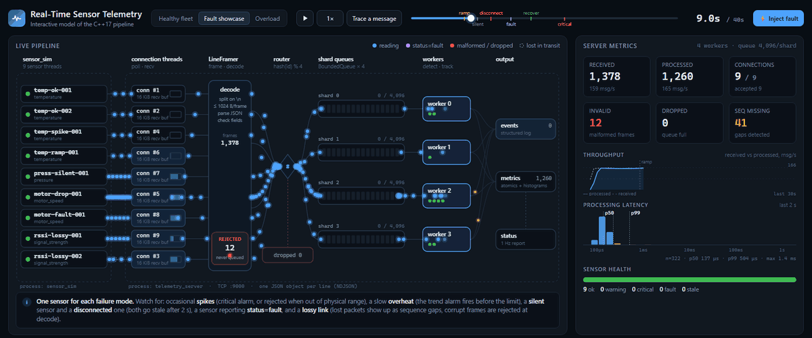
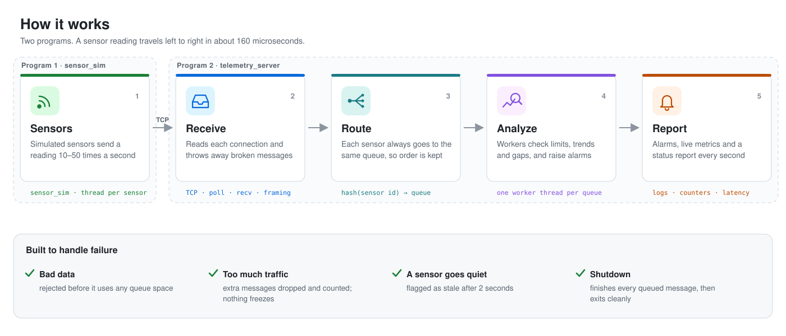
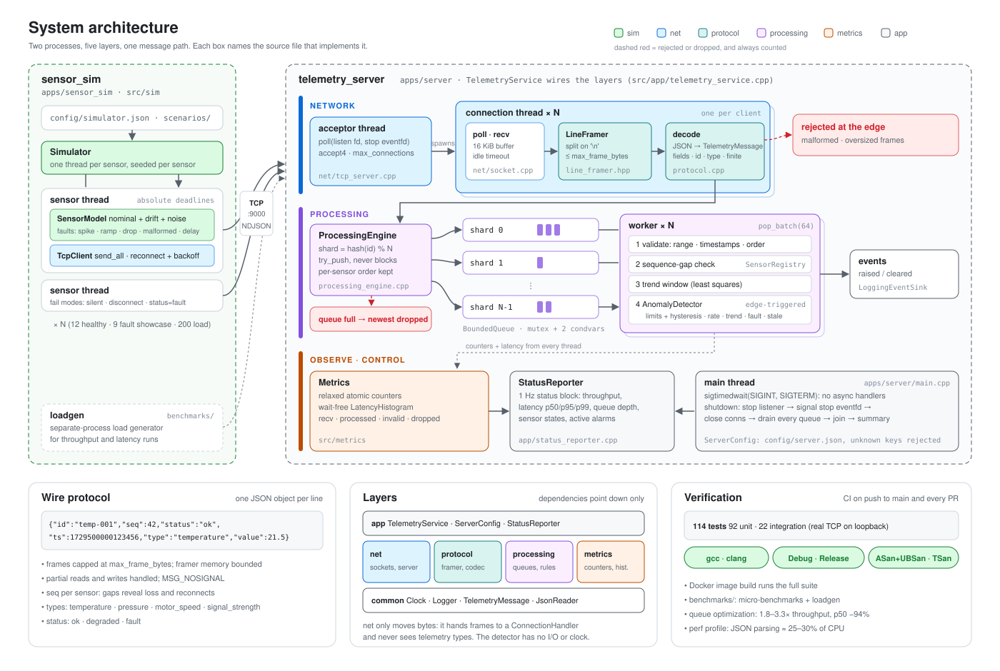

# Real-Time Sensor Telemetry and Control Simulator

A Linux C++17 system that simulates a fleet of sensors streaming telemetry over TCP to a
central service. The service processes readings concurrently, detects abnormal values and
failing sensors, and reports system health, throughput and latency.

**C++17 · Linux · POSIX sockets · std::thread · CMake · GoogleTest · Sanitizers · Docker · GitHub Actions**

<a href="https://shivang1141.github.io/Real-Time-Sensor-Telemetry-and-Control-Simulator/"></a>

**[▶ Open the interactive visualizer](https://shivang1141.github.io/Real-Time-Sensor-Telemetry-and-Control-Simulator/)**:
watch every message move through the server, follow a single message step by step, or
inject faults yourself and see how the server detects them. It runs in the browser with no
install ([details](#interactive-visualizer)).

> **Scope.** This is an independent educational project using synthetic data and public
> tools. It is not flight or defense software, is not certified for any safety-critical
> use, and makes no hard real-time guarantees. Latency is measured, not bounded.

## Engineering objectives

| Objective | How it is demonstrated |
|---|---|
| Linux systems programming | POSIX sockets, `poll`, `eventfd`, `accept4`, synchronous signal handling with `sigtimedwait`, `MSG_NOSIGNAL`, RAII file descriptors |
| Networking | Multi-client TCP server, explicit NDJSON framing, correct partial reads and writes, bounded per-connection memory, connection limits, idle timeouts, client reconnection with backoff |
| Concurrency | Producer-consumer pipeline over bounded queues sharded by sensor, wait-free metrics, graceful shutdown with no lost work; ThreadSanitizer-clean |
| Simulation | Deterministic signal models with noise, drift and injectable faults: spikes, ramps, packet loss, malformed frames, delays, silent / disconnect / fault-status failures |
| Algorithms | Threshold detection with hysteresis, windowed rate of change, least-squares trend, stale-data detection, sequence-gap detection |
| Testing | 114 unit and integration tests run under Debug, Release, ASan+UBSan and TSan |
| Performance | Separate-process load generator, repeatable benchmark harness, `perf` profiling, a measured 2–3× optimization of the queue |

## Architecture

<picture>
  <source media="(prefers-color-scheme: dark)" srcset="docs/system-overview-dark.svg">
  
</picture>

<details>
<summary><b>Detailed design</b>: every thread, queue and source file</summary>
<br>
<picture>
  <source media="(prefers-color-scheme: dark)" srcset="docs/architecture-dark.svg">
  
</picture>
</details>

* **Network layer.** One acceptor thread and one thread per connection. Each connection
  thread reads with `poll` and `recv` and splits the byte stream with a `LineFramer` that
  never buffers more than `max_frame_bytes`. Frames are decoded and validated on the
  network thread, so malformed input never consumes queue capacity.
* **Processing.** Messages are routed by `hash(sensor_id)` to one of N bounded queues, each
  drained by its own worker. That keeps every sensor's messages in order and its state
  owned by a single thread. If a queue is full the newest message is dropped and counted;
  network threads never block.
* **Detection.** Physical-plausibility and timestamp validation, warning and critical limits
  with hysteresis, rate of change, trend, sensor self-reported faults, staleness and
  sequence gaps. Events are edge-triggered (raised and cleared), not repeated per message.
* **Shutdown.** SIGINT/SIGTERM stops the listener, closes connections, drains every queued
  message, joins all threads and prints a final summary.

Full details are in [docs/ARCHITECTURE.md](docs/ARCHITECTURE.md): data flow, thread model,
synchronization inventory, protocol, failure behavior and the shutdown sequence.

## Interactive visualizer

[`visualizer/index.html`](visualizer/index.html) is a single self-contained page
([live version](https://shivang1141.github.io/Real-Time-Sensor-Telemetry-and-Control-Simulator/))
that animates the pipeline above one message at a time:

* **Three scenarios** from `config/`: a healthy fleet, the fault showcase, and an
  under-provisioned server where the queue fills up and the drop-newest policy takes over.
* **Trace a message** follows one reading through six steps: sensor thread, connection
  thread, decode, routing, worker and metrics. Each step shows the real frame, shard,
  detector inputs and the source file involved.
* **Inject fault** applies a spike, overheat, silence, disconnect, fault status or lossy link
  to any sensor while the scenario runs.
* The **status console** tab prints the same status block as `telemetry_server`.

It is a JavaScript model of the server, not the C++ binary. The sensor model, thresholds,
validation, sequence-gap check, hysteresis, rate, trend and stale rules, the
`hash(id) % N` sharding, `pop_batch(64)` and the drop-newest policy follow the C++ source.
Each message's trip is slowed down so it can be followed on screen; real processing
latency is about 160 µs. The overload scenario is scaled down 12.5× (800 msg/s instead of
10k) so every message can be drawn. Runs are deterministic: the same scenario always plays
out the same way. To run it locally, open the file in a browser.

## Quick start

Prerequisites: Ubuntu 22.04/24.04 (or WSL2), a C++17 compiler (GCC ≥ 11 or Clang ≥ 14),
CMake ≥ 3.22, Ninja.

```bash
sudo apt-get install -y build-essential cmake ninja-build libgtest-dev nlohmann-json3-dev
cmake --preset release
cmake --build --preset release
ctest --preset release
```

If `nlohmann-json3-dev` or `libgtest-dev` is not installed, CMake downloads pinned
versions automatically.

Run the server and a healthy sensor fleet in two terminals:

```bash
./build/release/apps/telemetry_server --config config/server.json
./build/release/apps/sensor_sim --config config/simulator.json
```

Or run the scripted fault-injection demo, which takes about 40 s:

```bash
scripts/demo.sh
```

With Docker (the image build also runs the full test suite):

```bash
docker compose up --build
SIM_CONFIG=scenarios/faults.json docker compose up
```

## Example output

A status block from a real run of the fault scenario, 20 s in. One sensor is reporting a
fault, a lossy-link sensor shows a rate-of-change warning, and the ramping temperature
sensor has crossed its warning limit while its trend alarm is active:

```
---- status t=20.0s ----
  connections   active=9 accepted=10 rejected=0
  messages      recv=2746 (116/s) processed=2714 (115/s)
  errors        invalid=32 oversized=0 rejected=1 dropped=0 seq_missing=103
  queue         depth=0/16384 peak_shard=3 workers=4
  latency(us)   interval n=574 mean=166.4 p50=159 p95=271 p99=359 max=487
  sensors       total=9 ok=6 warning=2 critical=0 fault=1 stale=0 | active warnings=3 critical=1
    motor-fault-001      motor_speed      fault     value=2978.929   age=1ms [sensor_fault]
    rssi-lossy-002       signal_strength  warning   value=-61.339    age=23ms [rate_of_change]
    temp-ramp-001        temperature      warning   value=94.478     age=1ms [warn_high,trend]
```

`invalid` matches the simulator's injected malformed frames exactly. `seq_missing`
equals the injected packet drops, plus malformed frames (each one consumes a sequence
number), plus rejected readings.

## Configuration

Both programs take a JSON configuration file. Comments are allowed, and **unknown keys
are rejected** so typos fail loudly with a precise path (for example
`network.prot: unknown field`). Every server field is optional.

| File | Purpose |
|---|---|
| `config/server.json` | Server defaults, all fields documented by example: network limits, worker count, queue capacity, detection thresholds per sensor type, logging |
| `config/simulator.json` | 12 healthy sensors across all four types |
| `config/scenarios/faults.json` | One sensor group per failure mode (spike, ramp, silent, disconnect, fault status, lossy link) |
| `config/scenarios/many_sensors.json` | 200 sensors / connections at 50 Hz (~10k msg/s) |
| `config/scenarios/overload_server.json` | Deliberately under-provisioned server to demonstrate saturation and the drop policy |

Command-line flags override common settings: `telemetry_server --help`,
`sensor_sim --help`.

## Testing

```bash
ctest --preset debug          # -Werror build, all 114 tests
cmake --preset asan && cmake --build --preset asan && ctest --preset asan
cmake --preset tsan && cmake --build --preset tsan && ctest --preset tsan
```

* **92 unit tests** cover the protocol parser, framer, bounded queue (including
  multi-producer stress), every anomaly rule, sensor state transitions with an injected
  clock, histogram accuracy, configuration validation and the simulator's fault model.
* **22 integration tests** use real TCP on loopback: concurrent clients, byte-by-byte and
  randomly fragmented frames, oversized and malformed input, disconnects mid-frame, idle
  timeouts, connection limits, queue saturation with exact accounting, graceful shutdown
  draining, stale detection, and simulator reconnection.

The suite passes in Debug, Release, ASan+UBSan and TSan. The integration tests were repeated
20× (and 8× under sanitizers) in parallel without a failure. See
[docs/TESTING.md](docs/TESTING.md).

## Performance

Measured on an Intel i5-1245U laptop under WSL2, with the load generator on the same
machine. Each figure is the median of 3 × 10 s runs.

| Scenario | Result |
|---|---|
| Normal load, 20k msg/s | 0 drops, latency p50 287 µs / p99 1.1 ms |
| Unbatched sends, 10k msg/s | p50 115 µs |
| Max throughput, 2 workers | ~381k msg/s |
| Worker scaling at 20 µs work/msg | 1 → 8 workers: 24.9k → 124k msg/s (5.0×) |
| 2× overload | processes 90% of theoretical capacity, drops and counts the rest, memory flat at 4 MB |
| Queue optimization (found by benchmarking) | 1.8–3.3× throughput, p50 latency −94% |

`perf` shows JSON parsing is now the main cost (about 25–30% of CPU). Methodology, the
before/after comparison, the profile and the bottleneck analysis are in
[docs/PERFORMANCE.md](docs/PERFORMANCE.md).

## Project structure

```
include/telemetry/   public headers: common, protocol, net, processing, metrics, app, sim
src/                 implementation (mirrors include/)
apps/                telemetry_server and sensor_sim entry points
tests/               unit/ and integration/ GoogleTest suites
benchmarks/          component micro-benchmarks, load generator, recorded results
config/              server, simulator and scenario configurations
scripts/             demo, benchmark runner, results summarizer
docs/                architecture, metrics, testing and performance write-ups, diagrams
visualizer/          interactive browser model of the pipeline (single HTML file)
```

## Known limitations

* Thread-per-connection is simple but will not scale to tens of thousands of clients; an
  `epoll` loop would be the next step.
* JSON parsing is the dominant CPU cost at high rates (see the profile in PERFORMANCE.md).
* No authentication or TLS: run it on trusted networks only.
* Sensor state is in memory only; there is no persistence or replay.
* No real-time scheduling, CPU pinning or memory locking, so tail latency is subject to
  normal OS scheduling. Benchmarks were run under WSL2 on a laptop.
* End-to-end latency is only meaningful with synchronized clocks; the headline latency
  figure is server-side processing latency.

## Future work

* SAX-based or schema-specific parsing to remove DOM allocation (about 25–30% of CPU).
* Producer-side batching (one queue operation per `recv` chunk) to cut wake-ups.
* `epoll`-based networking and a binary protocol option for high-rate sensors.
* Prometheus-style metrics endpoint and a small web dashboard.
* Command channel (server → sensor), to cover the "control" half of the name.
