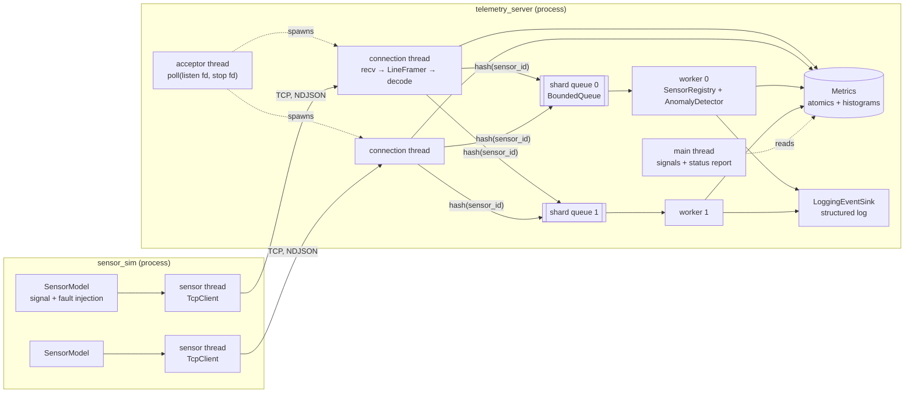
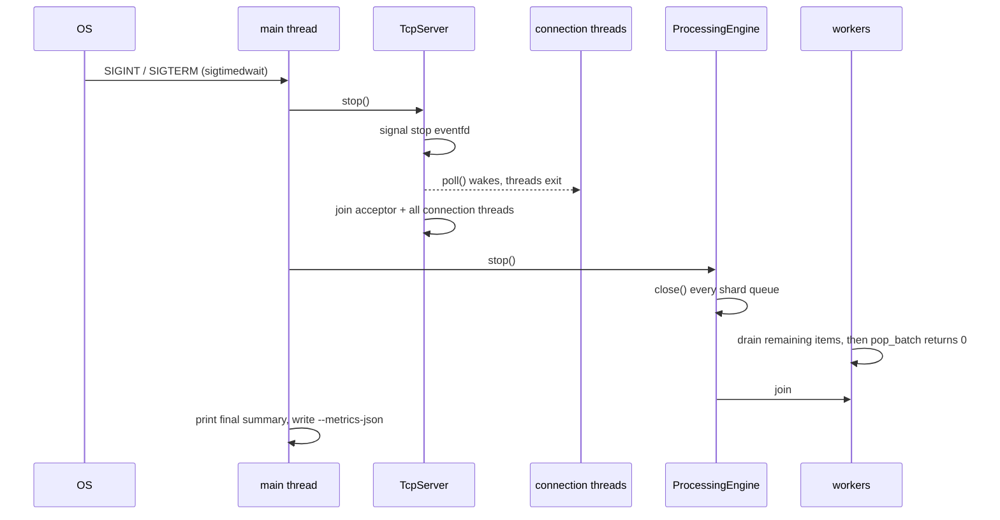

# Architecture

This document describes how the telemetry simulator is put together: components, data
flow, thread model, wire protocol, error handling and shutdown. It reflects the code in
this repository; file references point at the implementation.

> This is an educational simulation using synthetic data. It is not flight software, it is
> not certified for any safety-critical use, and it makes no hard real-time guarantees.
> Latency is *measured*, not bounded.

## 1. Components



| Layer | Responsibility | Key files |
|---|---|---|
| Protocol | Wire format, framing, validation | `protocol/protocol.*`, `protocol/line_framer.hpp` |
| Network | Sockets, accept loop, per-connection I/O, connection limits | `net/socket.*`, `net/tcp_server.*`, `net/tcp_client.*` |
| Processing | Bounded queues, workers, sensor state, anomaly rules | `processing/*` |
| Metrics | Counters, latency histograms | `metrics/*` |
| Application | Wiring, config, status output | `app/*`, `apps/server/main.cpp` |
| Simulation | Synthetic signals, fault injection, sensor threads | `sim/*`, `apps/sensor_sim/main.cpp` |

Dependencies point downward only. The anomaly detector knows nothing about sockets or
threads; the network layer knows nothing about telemetry (it delivers byte frames to a
`ConnectionHandler`). `TelemetryService` is the only place they meet.

## 2. Data flow of one message

1. **Sensor thread** (`Simulator::run_sensor`) wakes at its next absolute deadline, asks
   `SensorModel` for a sample, applies faults (drop / corrupt / delay), encodes it as one
   JSON line and writes it with `send_all` (handles partial writes and `EINTR`).
2. **Connection thread** (`TcpServer::connection_loop`) wakes from `poll`, calls `recv`
   into a 16 KiB buffer and feeds the bytes to its `LineFramer`. Each complete line is a
   frame, timestamped `received_at` with the steady clock.
3. `TelemetryService::on_frame` **decodes** the frame on the same thread. Malformed
   frames are counted and logged (rate-limited) and never reach a queue.
4. `ProcessingEngine::submit` picks shard `hash(sensor_id) % workers` and calls
   `try_push`. If the shard is full the message is **dropped and counted**; the network
   thread never blocks.
5. **Worker thread** drains up to 64 items per lock acquisition (`pop_batch`). For each:
   semantic validation → sequence-gap check → trend window update → condition
   evaluation → edge-triggered events → metrics.
6. Events go to `LoggingEventSink`; the main thread periodically snapshots metrics and
   sensor state and prints the status block.

## 3. Thread model

| Thread | Count | Blocks on | Owns / writes |
|---|---|---|---|
| main | 1 | `sigtimedwait` (SIGINT/SIGTERM) with a timeout for status printing | nothing shared |
| acceptor | 1 | `poll(listen_fd, stop_eventfd)` | connection list (under mutex) |
| connection | 1 per client, ≤ `max_connections` | `poll(socket, stop_eventfd)` | its framer and buffer; increments metrics |
| worker | `processing.workers` | `pop_batch` on its shard's condition variable | its shard's `SensorRegistry` |

Design decisions:

* **Thread-per-connection** keeps the network code linear and easy to verify. The
  simulator targets hundreds of connections, which this handles comfortably; the
  connection cap bounds the thread count. An `epoll` event loop would be the next step for
  tens of thousands of connections. Benchmarks did not show the network threads to be the
  limiting factor at the tested scale (see `PERFORMANCE.md`).
* **Sharded queues, one worker per shard.** With a single shared queue, two workers can
  take consecutive messages of one sensor and finish them out of order, which corrupts
  sequence-gap detection and trend windows. Routing by sensor ID preserves per-sensor
  order and means each sensor's state is written by exactly one thread. The trade-off is
  load imbalance if a few sensors dominate traffic.
* **Signals handled synchronously.** SIGINT/SIGTERM are blocked in every thread (the mask
  is set before any thread starts) and consumed by the main thread with `sigtimedwait`, so
  no logic runs inside an asynchronous signal handler. SIGPIPE is ignored and all sends
  use `MSG_NOSIGNAL`.
* **Shutdown wake-up via eventfd.** A single `eventfd` is polled by the acceptor and every
  connection thread. Writing to it once makes it permanently readable, waking all of them.
* **No global mutable state.** The logger, metrics and clock are objects passed by
  reference. Tests inject a `ManualClock` to control time.

### Synchronization inventory

| Shared data | Protection | Notes |
|---|---|---|
| Shard queue | mutex + 2 condition variables | `try_push` has a lock-free "full" fast path via an atomic size hint |
| Sensor registry (per shard) | mutex | written only by its worker; read by the status reporter ~1/s |
| Metrics counters | relaxed atomics | statistics only, no ordering needed |
| Latency histograms | relaxed atomic buckets | wait-free `record()` |
| Connection list | mutex | touched only by acceptor, reaper and `stop()` |
| Logger output | mutex | lines are formatted before the lock is taken |

There is no code path that holds two of these locks at once, so lock-ordering deadlocks
are impossible by construction. ThreadSanitizer runs the full test suite in CI.

## 4. Wire protocol

Newline-delimited JSON over TCP, one object per line (UTF-8, `\n` terminated, optional
`\r` tolerated):

```json
{"id":"temp-001","seq":42,"status":"ok","ts":1729500000123456,"type":"temperature","value":21.5}
```

| Field | Type | Rules |
|---|---|---|
| `id` | string | required, 1–64 chars of `[A-Za-z0-9._-]` |
| `type` | string | required: `temperature`, `pressure`, `motor_speed`, `signal_strength` |
| `value` | number | required, finite |
| `ts` | integer | required, sender wall clock in µs since the Unix epoch, > 0 |
| `seq` | integer | required, unsigned, +1 per generated sample, restarts at 0 on sensor restart |
| `status` | string | optional: `ok` (default), `degraded`, `fault` |

Unknown fields are ignored (forward compatibility). Why NDJSON: it is human-readable and
debuggable with `nc`/`jq`, and newline framing is trivial to implement correctly. The cost,
measured in `PERFORMANCE.md`, is parsing CPU, which is the main remaining hotspot.

**Framing and memory bounds.** `LineFramer` buffers at most `max_frame_bytes` (default
1024) of an incomplete line per connection. A longer line is reported as oversized, its
bytes are discarded up to the next newline, and framing resynchronizes, so a client
cannot make the server allocate unbounded memory.

## 5. Validation and anomaly detection

Validation happens in two stages:

1. **Syntactic** (network thread, `protocol::decode`): JSON well-formed, required fields
   present with correct types, enumerations known, ID charset, timestamp range.
2. **Semantic** (worker, `AnomalyDetector::validate`), relative to the sensor's previous
   accepted message: physically plausible range (`valid_min/valid_max`), timestamp not
   more than `max_future_skew` ahead of or `max_message_age` behind the receiver clock,
   sequence strictly increasing, timestamp non-decreasing, sensor type unchanged.
   Rejected messages are counted and do not update sensor state.

Conditions (persistent, edge-triggered; `events.hpp`):

| Condition | Rule | Severity |
|---|---|---|
| `warn_low/high` | outside `[warn_low, warn_high]`, clears with hysteresis | warning |
| `crit_low/high` | outside `[crit_low, crit_high]`, clears with hysteresis | critical |
| `rate_of_change` | slope against the newest sample ≥ `rate_interval` old exceeds `max_rate_per_s` | warning |
| `trend` | least-squares slope over the last `trend_window` samples exceeds `max_trend_per_s` | warning |
| `sensor_degraded` / `sensor_fault` | self-reported status | warning / critical |
| `stale` | no accepted message for `stale_after` | critical |

One-off events: `sequence_gap` (with the number of missing messages),
`measurement_rejected`, `sensor_registered`, `sensor_restarted`.

Sensor health is derived from active conditions with priority
`stale > fault > critical > warning > ok`.

Rate of change deliberately does **not** compare consecutive samples. The first version
did, and the fault-scenario demo showed constant false alarms on 50 Hz sensors: noise
divided by a 20 ms interval looks like a steep slope. Measuring against a reference about
500 ms back removes that while still catching spikes.

## 6. Error handling and failure behavior

| Situation | Behavior | Where |
|---|---|---|
| Malformed JSON / missing field / bad type | counted as `invalid`, logged (≤10/s), connection kept | `TelemetryService::on_frame` |
| Frame longer than `max_frame_bytes` | counted as `oversized`, discarded, resync at next `\n` | `LineFramer` |
| Physically implausible value, bad timestamp, duplicate sequence | counted as `rejected`, sensor state unchanged | `SensorRegistry::update` |
| Missing sequence numbers | `sequence_gap` event, `seq_missing` counter | `SensorRegistry::update` |
| Sensor stops sending | `stale` raised after `stale_after`, cleared on next accepted message | `SensorRegistry::check_stale` |
| Client disconnects (clean or reset) | connection thread exits, partial trailing frame discarded | `TcpServer::connection_loop` |
| Client idle beyond `idle_timeout` | connection closed | `TcpServer::connection_loop` |
| More than `max_connections` clients | accepted and closed immediately, counted | `TcpServer::accept_one` |
| Out of file descriptors (`EMFILE`) | logged, accept loop backs off 50 ms instead of spinning | `TcpServer::accept_one` |
| Shard queue full | message dropped (drop-newest), counted, logged ≤1/s | `ProcessingEngine::submit` |
| Thread creation fails | connection closed, logged | `TcpServer::accept_one` |
| Port already in use | `start()` throws, process exits with status 1 | `listen_tcp` |
| Server unreachable (simulator side) | sensor keeps its schedule, counts lost samples, reconnects with exponential backoff (200 ms → 5 s) | `Simulator::run_sensor` |
| Flood of alarm transitions | every event counted; log lines limited to 200/s with a `suppressed` count | `LoggingEventSink` |

**Why drop-newest on overload?** Blocking the network thread would push backpressure into
TCP, but it would also stall every sensor sharing that connection and hide overload from
the metrics. Dropping keeps memory bounded, keeps the freshest picture of healthy shards,
and makes overload visible as `dropped` (server side) and `sequence_gap` (per sensor).

## 7. Shutdown sequence



Order matters: the network stops first so nothing new is enqueued; then the queues are
closed and **drained**, so every message accepted into a queue is processed before exit
(verified by `GracefulShutdownDrainsQueuedMessages`). Shutdown time is bounded by the
queue capacity times the per-message processing cost. Messages still in kernel socket
buffers at shutdown are not read; clients see the connection close.

## 8. Time

* **Durations and latency** use `std::chrono::steady_clock` (monotonic).
* **Message timestamps** use the sender's wall clock (`system_clock`, µs since epoch).
* **Processing latency** = frame received → processing finished, both on the server's
  steady clock. This is exact and needs no clock synchronization.
* **End-to-end latency** = receiver wall clock − sender timestamp. It is only meaningful
  when sender and receiver share a host or are NTP/PTP-synchronized; the server reports it
  separately and never mixes it with processing latency.

## 9. Known limitations

* Thread-per-connection does not scale to tens of thousands of connections (use `epoll`).
* No authentication or encryption on the TCP port. Do not expose it to untrusted networks.
* Sensor state lives in memory only; restarting the server forgets it.
* Sharding by sensor ID can be imbalanced if a few sensors dominate traffic.
* JSON parsing dominates CPU at high message rates (see `PERFORMANCE.md`).
* A connection is not tied to a sensor identity: any client may send any sensor ID.
* No real-time scheduling (`SCHED_FIFO`, CPU pinning, memory locking) is used. Tail
  latency is therefore subject to normal OS scheduling.
